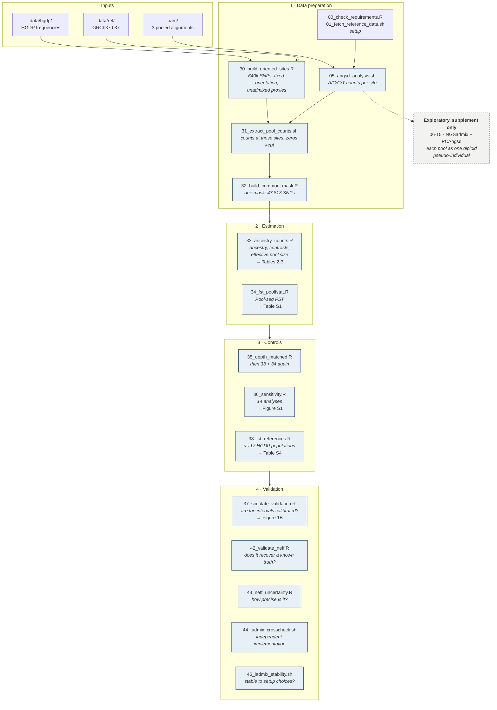

# Pipeline

Code for the pooled-sequencing ancestry analysis of three cohorts from
Barranquilla, Colombia. Everything here runs from the repository root.

The repository is **code only**: no sequencing data, no derived per-site data,
no results. See `DATA_AVAILABILITY.md` for what can and cannot be reproduced,
and for the controlled-access route to the underlying alignments.

## Pipeline at a glance



Everything above runs with one command:

```bash
bash bin/run_pipeline.sh
```

## Running it on another machine

```bash
Rscript bin/00_check_requirements.R     # what is missing, before anything long starts
bash    bin/01_fetch_reference_data.sh  # downloads the two public reference files
bash    bin/run_pipeline.sh             # the analysis
```

Requirements: R >= 4.1 with `data.table` (>= 1.14) and `poolfstat` (>= 3.0);
samtools; gzip; awk; a C compiler for the two iAdmix scripts; and ANGSD, but
only for `bin/05`, which produces the read counts — if those already exist the
rest of the pipeline does not need it. Tested on macOS (Apple silicon) and
written to be POSIX-portable; on Windows `parallel::mclapply` does not fork, so
the jackknife and the simulations run serially and take considerably longer.

Reference data are public but too large for the repository, so
`bin/01_fetch_reference_data.sh` downloads them: the UCSC `hgdpGeo` allele
frequencies (~53 MB) and the GRCh37/b37 reference genome (~3 GB), which it also
indexes. The three pool alignments in `bam/` are controlled access; see
`DATA_AVAILABILITY.md`.

Every random step is seeded (20260925), so two machines should produce
identical output.

To check the pipeline without any participant data, run it against the
synthetic count set written by `bin/37` (`out_global/revision/synthetic_test/`),
which ships with its expected output.

## 1. Primary analysis

These scripts produce every result in the main text.

| Script | What it produces |
|---|---|
| `00_check_requirements.R` | Verifies tools, R packages and input files, and stops the run early if something is missing |
| `01_fetch_reference_data.sh` | Downloads and indexes the two public reference files |
| `05_angsd_analysis.sh` | Per-site A/C/G/T read counts per pool (ANGSD `-doCounts -dumpCounts`, MAPQ ≥ 30, BQ ≥ 20). ANGSD is used here only as a read counter; its allele-frequency estimator assumes one diploid individual and is not used |
| `30_build_oriented_sites.R` | 640,126 autosomal HGDP SNPs coded once as ancestral/derived; unadmixed source proxies (AFR, EUR, NAT) plus five alternatives for sensitivity |
| `31_extract_pool_counts.sh` | Pool read counts at those sites, zero counts retained as data |
| `32_build_common_mask.R` | One SNP mask applied to every cohort and every analysis (47,813 SNPs); QC summary |
| `33_ancestry_counts.R` | Beta-binomial ancestry model using the real pool sizes; cohort contrasts; block jackknife; effective pool size with its interval |
| `34_fst_poolfstat.R` | Pool-seq F<sub>ST</sub> (poolfstat ANOVA) with block jackknife |
| `35_depth_matched.R` | Site-by-site depth matching (hypergeometric thinning) |
| `36_sensitivity.R` | Fourteen sensitivity analyses: transversions, depth and quality filters, MAF, five alternative proxy panels, block size, reference bias |
| `37_simulate_validation.R` | Simulation of the full design; writes the synthetic test set |
| `38_fst_references.R` | Pool-vs-HGDP Hudson F<sub>ST</sub> on the common mask |
| `lib_poolmix.R` | Shared model, jackknife, blocks, effective-size estimator |

`run_pipeline.sh` is the entry point and runs all of the above, then the
validation below, in order.

## 2. Validation

| Script | What it answers |
|---|---|
| `42_validate_neff.R` | Does the effective-size estimator recover a known truth? Sweep over pool size, depth and contribution unevenness (480 simulated pools) |
| `43_neff_uncertainty.R` | How precise is the effective size reported for a given library? Simulates the study as run and solves the inverse problem |
| `44_iadmix_crosscheck.sh` | Independent implementation check with iAdmix (Bansal and Libiger 2015), which has its own likelihood, optimizer and codebase |
| `45_iadmix_stability.sh` | How much does the iAdmix answer depend on how the run is set up: repeats, pool size, SNP subset, allele orientation |

### Two traps worth knowing about

Both are silent: no error, no warning, a plausible-looking wrong answer.

**Allele orientation.** Pairing read counts with the frequency of the *other*
allele changes the African-related estimate from 14% to 47%. `bin/44` runs both
orientations and keeps the one the program itself scores higher; the two differ
by a factor of about 30 in log-likelihood, so the choice is unambiguous.

**Pool size in chromosomes.** iAdmix's `-p` is the number of chromosomes, not of
people: 100 for a 50-person pool. `bin/45` shows this one is forgiving — it
moves the answer by about 0.3 percentage points.

## 3. Exploratory (supplementary material only)

Genotype-likelihood analyses that preceded the count-based model. They are
reported in the supplement as exploratory and carry none of the conclusions:
NGSadmix and PCAngsd consume the Beagle format, which represents each pool as a
single diploid pseudo-individual and discards the pool size entirely.

| Script | What it produces |
|---|---|
| `06_build_5pop_panel.sh` | Reference panel for the genotype-likelihood route |
| `11_full_genome_panels.sh` | 1000 Genomes genotype extraction |
| `07_build_ref_beagle.R`, `07b_build_ref_beagle_v2.R` | Reference Beagle files (continental, granular) |
| `08_merge_beagle_ngsadmix.R`, `08b_…_v2.R` | Merge pools with the reference |
| `12_rebuild_and_run.sh` | Runs NGSadmix and PCAngsd across K |
| `10_evanno_deltaK.R` | Evanno ΔK |
| `09_plot_admixture_pca.R`, `09b_…_v2.R`, `14_pool_focused_plots.R`, `15_final_figures.R` | Plots |
| `lib_build_ref_beagle_panel.R` | Shared helper |

One input of this route cannot be regenerated: `pools_hapmap3.beagle.gz` was
produced by an ANGSD command preserved only in its own `.arg` file, which reads
two site lists that were written to `/tmp` and no longer exist. This is stated
in `DATA_AVAILABILITY.md`.

## Removed from this repository

Seven scripts were removed once the analyses they produced were retracted or
dropped. They remain in the git history and can be recovered with `git show`.

- `05a_fst_from_counts.R`, `05c_continental_ancestry_v3.R`,
  `05d_fst_per_population.R` — the earlier F<sub>ST</sub> route. It defined the
  minor allele separately within each pool, averaged per-site ratios instead of
  taking a ratio of sums, and used thresholds other than those its output was
  described with. The tables it produced are superseded by `bin/34` and `bin/38`.
- `16_pool_replicates.sh`, `16b_summarize_replicates.R` — jackknife over the
  genotype-likelihood results, superseded by the jackknife in `bin/33`.
- `17_summarize_mixemt.R`, `20_new_findings_figures.R` — mitochondrial and
  chromosome X analyses, and their figures. Both analyses were dropped: sex
  composition is unknown, and read proportions from a mixed mitochondrial
  library are not maternal haplogroup frequencies.

## Software

ANGSD 0.940; samtools 1.23 and bcftools 1.23; R 4.5.2 with data.table 1.18.2
and poolfstat 3.1.0; bwa 0.7.17 and 0.7.19; Sentieon 202010.04; iAdmix
(compiled from the source in `data/iadmix/`). Pool sizes used throughout:
POOL1 = 50, POOL2 = 50, HOSPITAL = 200 people.
